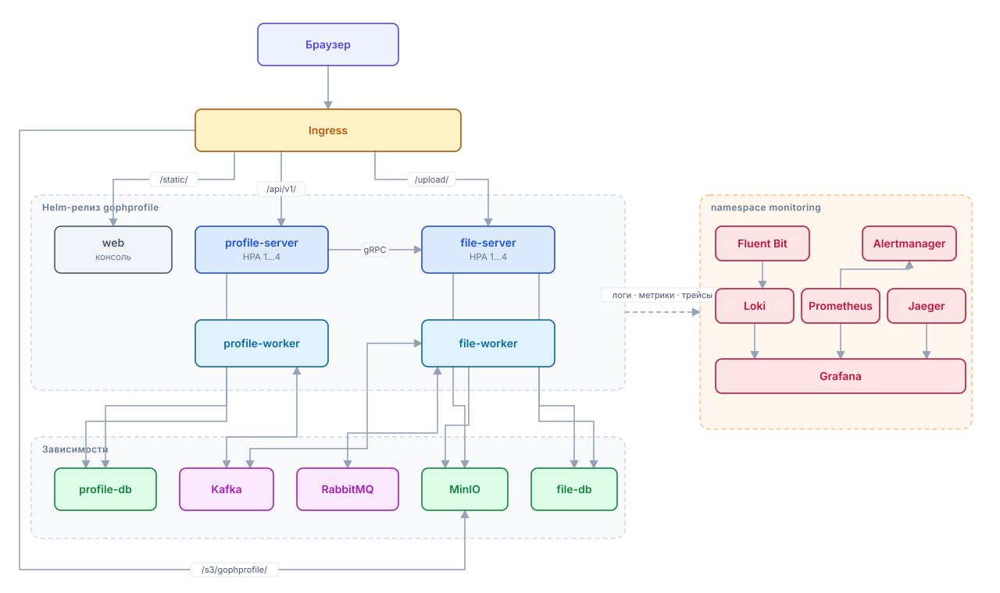

# GophProfile

Сервис хранения и раздачи аватарок. Пользователь загружает изображение, сервис
возвращает его в нескольких размерах, каждый по собственному постоянному
адресу. Такой адрес подставляется в `` на любой странице; аватарку
можно получить и по email владельца.

## Содержание

- [Границы сервисов](#границы-сервисов)
- [Как проходит загрузка](#как-проходит-загрузка)
- [Модель раздачи файлов](#модель-раздачи-файлов)
- [Распределение правил](#распределение-правил)
- [Что внутри](#что-внутри)
- [Наблюдаемость](#наблюдаемость)
- [Карта системы](#карта-системы)
- [Где что лежит](#где-что-лежит)

Отдельными документами: [локальная разработка](DEVELOPMENT.md) и
[развёртывание в Kubernetes](DEPLOYMENT.md).

## Границы сервисов

В задании был один сервис. Здесь их два.

**`file`** не знает про аватарки, пользователей и email и оперирует объектами.
Владелец для него — непрозрачная пара «пространство имён» и «ссылка на
владельца». Зона ответственности:

- выдача тикетов на загрузку и их завершение;
- проверка содержимого после загрузки: сигнатура, декодирование, лимиты;
- генерация вариантов;
- хранение метаданных объектов и вариантов;
- раздача содержимого под своим адресом, с проксированием из хранилища;
- физическое удаление объектов.

**`profile`** знает про продукт. Зона ответственности:

- профиль пользователя и связь email с текущей аватаркой;
- продуктовые правила: одна текущая аватарка, удалять можно только свою;
- оркестрация загрузки — клиент обращается только сюда;
- отдача заглушки, когда аватарки нет.

Что это даёт: завтра к file можно прийти за хранением документов или обложек, не трогая продуктовую логику. 
Чем платим: сетевой вызов, два брокера и два набора миграций.

## Как проходит загрузка

Байты не идут через сервисы. Браузер отправляет их прямо в хранилище по
временной подписанной ссылке:

```
1. браузер → profile    «хочу загрузить avatar.jpg, 200 КБ»
2. profile → file       по gRPC: выдай тикет
   profile → браузер    тикет: куда класть и с какими полями
3. браузер → хранилище  сами байты, минуя сервисы
4. браузер → profile    «я загрузил, забирай»
   profile → file       по gRPC: заверши загрузку
5. file (в фоне)        проверяет картинку, режет размеры, пишет в хранилище
   file → profile       событием: «готово, вот размеры»
6. profile              аватарка становится текущей
```

Пока шаг 5 не закончился, аватарка находится в статусе `processing`, и консоль
это показывает. Ответ на шаге 4 приходит сразу, дожидаться обработки не нужно.

Удаление идёт тем же путём в обратную сторону: `profile` помечает аватарку
удалённой и отправляет событие, `file` по нему удаляет файл и объекты из
хранилища.

## Модель раздачи файлов

Хранилище полностью приватное: анонимного чтения нет, публично читаемых
префиксов нет, подписанные ссылки на чтение наружу не выдаются. Единственный
способ получить содержимое — публичный эндпоинт `file`, который сам читает
объект из хранилища и передаёт ответ клиенту.

Публичная точка входа одна:

```
domain.com/api/...     → profile   HTTP
domain.com/upload/...  → file      HTTP, раздача содержимого
domain.com/s3/...      → хранилище только для подписанной загрузки
```

gRPC-порты наружу не проброшены.

Канонический адрес содержимого постоянный:

```
https://domain.com/upload/{file_id}/{variant}.{ext}
```

Ключ хранилища в адресе не отражается: соответствие пары «файл и вариант»
ключу живёт в базе `file`. Это позволяет менять раскладку бакета и само
хранилище, не ломая уже выданные ссылки.

Подписанные ссылки на чтение для этой задачи непригодны. Они живут не дольше
семи суток, уникальны при каждой выдаче и ломают кеширование: строка запроса
меняется, значит у браузера и CDN каждый раз промах. Для главного сценария —
сторонняя страница вставляет `` с аватаркой по email — это неприемлемо.

Проксирование окупается двумя уровнями кеширования с разным временем жизни:

| Ответ | Cache-Control |
|---|---|
| `/upload/{file_id}/{variant}.{ext}` | `public, max-age=31536000, immutable` |
| 302 от `profile` на текущую аватарку | `public, max-age=300` |

Содержимое по паре «файл и вариант» неизменяемо: новая аватарка — это новый
файл. Поэтому содержимое отдаётся как immutable и в норме до сервиса вообще не
доходит. Изменчив только указатель «текущая аватарка пользователя», и живёт он
в коротком редиректе:

```
GET /api/v1/users/{user_id}/avatar     → 302 на размер 300x300
GET /api/v1/emails/{email_hash}/avatar → то же самое, но по хешу email
```

Если аватарки нет, оба адреса отдают заглушку, а не 404: страница, вставившая
такую ссылку, не должна показывать битую картинку из-за того, что человек
ничего не загрузил. Email в адресе не передаётся, только sha256 от него, иначе
почта утекала бы в логи, в `Referer` и в историю браузера.

Условные запросы обслуживаются без обращения к хранилищу. `ETag` — это sha256
варианта из базы, а не идентификатор из хранилища: для составных загрузок тот
не равен контрольной сумме содержимого, опираться на него нельзя. Совпал
`If-None-Match` — ответ 304 после одного чтения по первичному ключу.

Раскладка бакета:

| Префикс | Содержимое | Доступ |
|---|---|---|
| `staging/{upload_id}` | незавершённые загрузки | запись по подписанной ссылке |
| `originals/{file_id}` | оригинал как загружен | только внутренние вызовы `file` |
| `variants/{file_id}/…` | 100x100, 300x300, web | раздаётся через `/upload/…` |

Оригинал наружу не отдаётся даже через проксирование: в нём остаются данные
EXIF, включая координаты съёмки. Варианты пересобираются из декодированных
пикселей, поэтому метаданные в них не попадают.

## Распределение правил

Правило принадлежит тому сервису, который отвечает за последствия его
нарушения.

**`file` владеет техническими ограничениями.** Они защищают хранение от
содержимого: что можно принять, сколько это может весить, во что раскрывается
при декодировании. `file` — единственный, кто видит байты, поэтому только он
может это проверить.

**`profile` владеет продуктовыми правилами.** Они описывают, что разрешено
пользователю: сколько аватарок держать, какая из них текущая, чью можно
удалять, что отдавать, когда аватарки нет.

Проверка правила и удобный ответ клиенту — не одно и то же. Правило
обеспечивается у владельца; у границы оно может дублироваться, чтобы ответить
раньше, но опираться на этот дубль нельзя. Обратное направление запрещено:
перенести обеспечение на край и доверять ему недопустимо.

Отсюда следуют два производных правила. Первое: ужесточать можно, ослаблять
нельзя — `profile` передаёт в запрос на загрузку максимальный размер, но это
просьба ужесточить, и `file` берёт минимум из запрошенного и своей политики.
Второе: защитные лимиты всегда остаются у `file`, потому что `profile` байтов
не видит.

| Правило | Определяет | Обеспечивает | Дублируется у границы |
|---|---|---|---|
| Допустимые MIME-типы | `file` | воркер: сигнатура и декодирование | `profile` → 400 |
| Максимальный размер файла | `file` | политика загрузки и проверка воркером | `profile` → 413 |
| Минимальные размеры изображения | `file` | воркер при чтении заголовка | — |
| Лимит пикселей | `file` | воркер до полного декодирования | — |
| Набор вариантов | `file`, конфигурация | воркер | — |
| Применение EXIF Orientation | `file` | воркер перед ресайзом | — |
| Удаление метаданных из вариантов | `file` | воркер, пересборка из пикселей | — |
| Раскладка ключей в хранилище | `file`, домен | типизированные конструкторы | — |
| Срок жизни тикета загрузки | `file` | поле в таблице и политика | — |
| Время жизни кеша содержимого | `file` | заголовок на раздаче | — |
| Право вызывать gRPC-API | `file` | перехватчик по токену | — |
| Идентичность вызывающего | `profile` | middleware, токен в контекст | — |
| Удалять можно только свою аватарку | `profile` | сравнение владельца | — |
| Одна текущая аватарка | `profile` | поле в профиле | — |
| Сколько аватарок можно держать | `profile` | подсчёт перед выдачей тикета | — |
| Заглушка, когда аватарки нет | `profile` | 302 на адрес заглушки | — |
| Связь email с пользователем | `profile` | уникальный индекс | — |
| Время жизни редиректа | `profile` | `Cache-Control: max-age=300` | — |
| Хранение событий | инфраструктура | настройка топика Kafka | — |

Один шов здесь неидеален. Набор вариантов — решение продуктовое, а живёт оно
в конфигурации `file`. Это цена правила «обеспечивает тот, кто видит байты»:
спецификация вариантов нужна воркеру, а не вызывающему.

## Что внутри

| Что | Зачем |
|---|---|
| Postgres ×2 | у каждого сервиса своя база, общих запросов нет |
| MinIO | хранилище объектов, S3-совместимое |
| RabbitMQ | команды: «обработай файл», «удали объекты» |
| Kafka | события: «файл готов», «аватарка удалена» |
| nginx | единственная публичная точка входа |
| Prometheus и Alertmanager | метрики и правила алертов |
| Jaeger | трейсы |
| Grafana | дашборды по метрикам и поиск по логам |
| Fluent Bit и OpenSearch | сбор логов и поиск по ним |

Команды и события разведены намеренно. Команда адресована одному исполнителю и
обязана выполниться, поэтому нужны подтверждение, повтор и очередь для
неудачных. Событие — это факт, у него может быть сколько угодно читателей, и
переспрашивать его бессмысленно.

Публикация в брокер всегда идёт через таблицу в той же транзакции, что и
изменение данных. Иначе регулярно получается «в базе есть, в брокер не ушло», и
аватарка навсегда остаётся в обработке.

Вызовы к соседнему сервису и к хранилищу прикрыты размыкателем. После
нескольких отказов подряд сервис перестаёт их вызывать и отвечает отказом
сразу, а когда пауза истекает, пробует одним запросом. Иначе упавшая
зависимость копит зависшие запросы, пока не кончатся соединения.

## Наблюдаемость

Если сервис замедлился или начал отдавать `500`, по логам одного контейнера
причину не найти: запрос проходит через точку входа, два сервиса, брокер и
воркер. Поэтому собираются три вида данных, и все три связаны между собой.

Каждая строка лога, у которой есть спан, несёт `trace_id` и `span_id`, и по
этому полю лог связан с трейсом в обе стороны. Трейс одного запроса идёт
целиком, включая брокер: сообщение уносит контекст трейса в своём конверте,
релей отправляет его своим спаном, а обработка на другой стороне продолжает тот
же трейс вместо того, чтобы начать новый.

Правил алертов одиннадцать: упавший сервис, доля 5xx, p95 API, медленная
раздача содержимого, припаркованные строки outbox, растущий бэклог, исчерпанные
попытки консьюмера, лаг Kafka, исчерпанный пул Postgres, доля неудачных
загрузок, разомкнутый вызов к зависимости. Правила, которые считают доли, на
малом трафике молчат: иначе одна ошибка в тишине даст сто процентов и разбудит
зря.

Адреса стенда — в [DEVELOPMENT.md](DEVELOPMENT.md), развёртывание стека
наблюдаемости в кластере — в [DEPLOYMENT.md](DEPLOYMENT.md).

## Карта системы



## Где что лежит

```
file/          сервис хранения: домен, use cases, адаптеры, транспорт
profile/       продуктовый сервис, устроен так же
internal/      общее: outbox, inbox, брокеры, транзакции, http, метрики
deploy/        Dockerfile каждого сервиса и конфиги стенда compose
deploy/helm/   чарт: шаблоны, values окружений, правила алертов, дашборды
deploy/k8s/    зависимости кластера и values его аддонов
assets/        схема архитектуры: генератор, SVG и исходник для draw.io
web/           консоль, которую отдаёт nginx
```

Внутри каждого сервиса порядок одинаковый: `domain` ничего не импортирует,
`usecase` описывает сценарии и объявляет порты интерфейсами, `adapter` их
реализует, `transport` принимает запросы, `app` всё это связывает.

API описан в OpenAPI: [profile/api/openapi.yaml](profile/api/openapi.yaml) и
[file/api/openapi.yaml](file/api/openapi.yaml).
